<p align="center">
  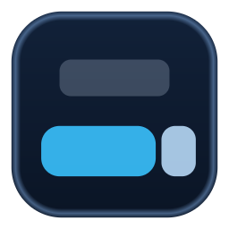
</p>

<h1 align="center">PuwBar</h1>

<p align="center"><b>Floating frosted glass taskbar for Windows 11, with every native feature intact.</b></p>

<p align="center">
  Splits the native taskbar into separate rounded glass pills for apps, the System Tray, and Widgets.<br>
  Written in Rust + C++/WinRT, ~750 KB Windows installer, no Windhawk, no Visual C++ Redistributable required.
</p>

<p align="center"><a href="README.md">Tiếng Việt</a> · <b>English</b> · <a href="https://github.com/erikpuw/puwbar/releases/latest"></a></p>

> **Download only from the author's source.** PuwBar is published by its author (erikpuw) only at [github.com/erikpuw/puwbar](https://github.com/erikpuw/puwbar). A copy from anywhere else (file-sharing sites, other repositories, repackaged builds, files sent over the internet) is not controlled by the author and comes with no guarantee: it may have been modified or had code added. Use only the build in this repository's [Releases](https://github.com/erikpuw/puwbar/releases).

## Features

| Feature | What it does |
|---|---|
| **Real frosted glass** | Real-time blur of whatever is behind the bar, a glass rim that catches the light, a soft shadow, and 12px rounded corners. Four styles to choose from. The glass darkens on its own over bright wallpapers so text stays readable, with nothing to tune. |
| **Native behavior intact** | Never hides or replaces Explorer. Keeps live tray animations (RunCat 365, UniKey), native right-click menus, the overflow icon grid, Start menu, and window previews. |
| **All 4 edges & Left/Center** | Adapts live when switching taskbar position (**Bottom / Top / Left / Right**) or alignment (**Left / Center**) in Windows Settings. |
| **Right-edge indicator fix** | Keeps the running-app indicator locked to the right edge on vertical right-docked taskbars. |
| **Matching glass everywhere** | Styles the System Tray pill, Start Menu, tray right-click menus, taskbar Jump Lists, hover tooltips, window thumbnail previews, Quick Settings, Notification Center, Calendar, overflow flyouts (`^`, `...`), and Widgets button. |
| **Smooth horizontal slide** | 300ms ease-in-out slide timed with Windows 11's app launch animation, VSync-locked to the monitor refresh rate. |
| **Lightweight & clean** | About 1.2 MB of RAM and 0% CPU at idle. Installs per-user with a standard entry in Windows Installed apps; exiting restores every XAML property cleanly. |
| **Tray menu** | Start with Windows, Taskbar style (Frosted Glass / Crystal Clear / Borderless with icon reflection / Flat Frosted), Glass surfaces (toggle each panel back to native Windows), Reapply taskbar glass, Language (Vietnamese / English), About, Exit (`Ctrl+Alt+F12`). |

**Start with Windows** asks for administrator permission once to create an immediate-logon Task Scheduler task (no startup delay, retries up to 30 seconds while Explorer XAML initializes). If UAC is declined, it falls back to `HKCU\...\Run`. Untick it to turn it off.

## Screenshots

| | |
|---|---|
| 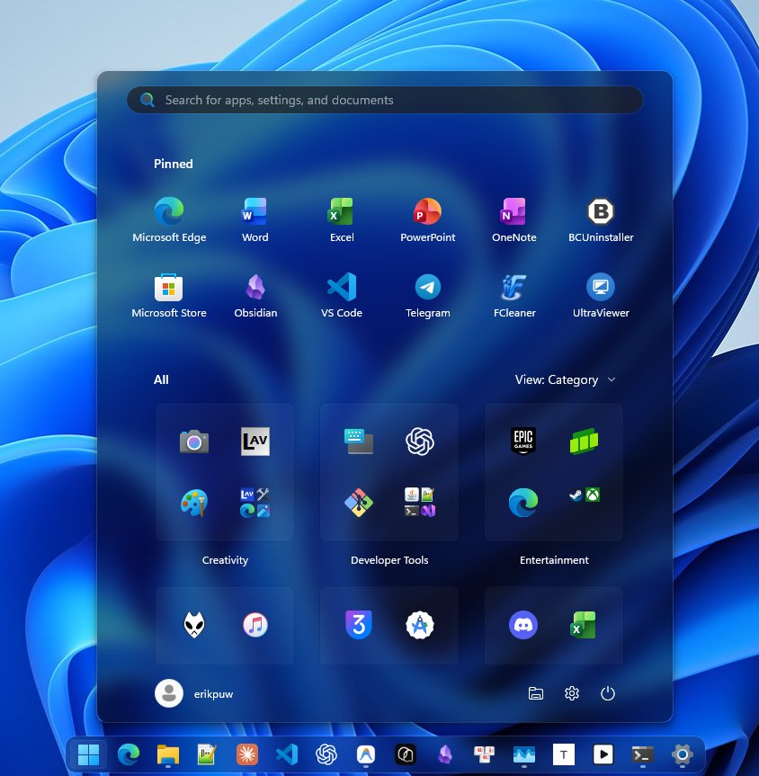<br>**Start Menu & Taskbar**: 12px rounded frosted glass with subtle hairline border | 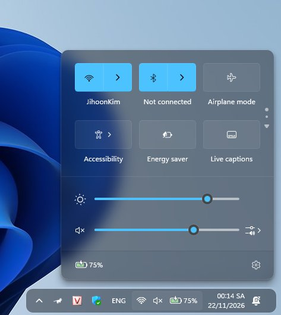<br>**Control Center & System Tray**: matching glass layer across both surfaces |
| 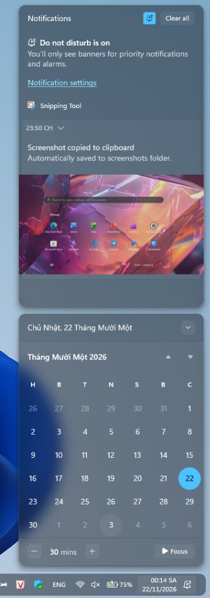<br>**Notifications & Calendar**: white text stays readable over bright areas | 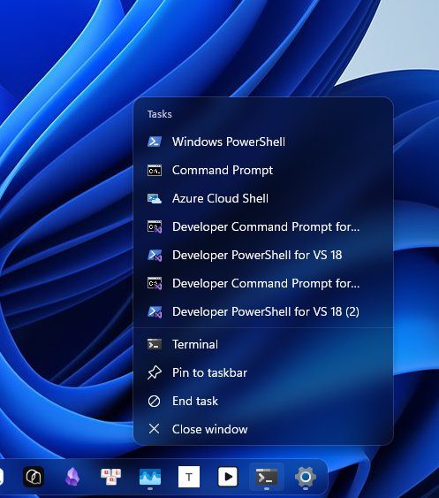<br>**Jump List**: right-click menu on taskbar app icons |
| 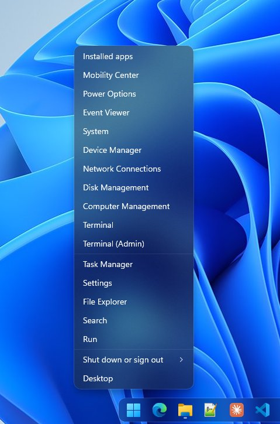<br>**Win+X Menu**: Start button context menu | 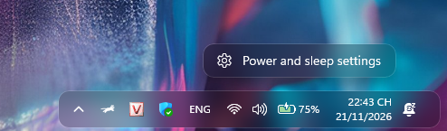<br>**System Tray Menu**: native left-click selection preserved |
| 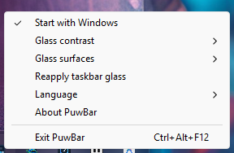<br>**PuwBar Menu (English)**: taskbar styles & per-surface toggles | 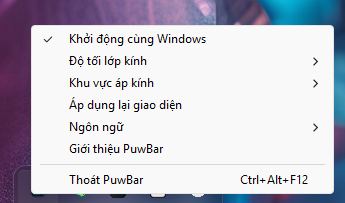<br>**PuwBar Menu (Vietnamese)**: switch language directly from the tray |

### Taskbar styles

Pick one from the tray menu under **Taskbar style**.

**Frosted Glass** (default): a light blur that still lets shapes show through, with a sheen on the glass.

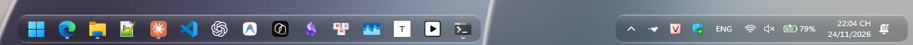

**Crystal Clear**: no blur, just a glass rim and a sheen.

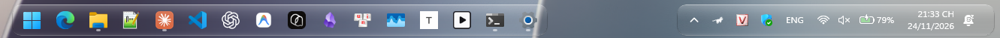

**Borderless (icon reflection)**: no frame; icons reflect downward as if standing on a glass table.


**Flat Frosted**: the v1.0.7 look, with a thin rim and no shadow.

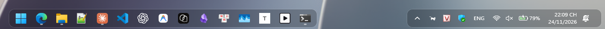

## Install & usage

1. If an older copy of PuwBar is currently running, exit it first (`Ctrl+Alt+F12` or **Exit PuwBar** in the System Tray).
2. Download `puwbar-setup-v<version>-x64.exe` (~750 KB) from [Releases](https://github.com/erikpuw/puwbar/releases/latest) and run it.
3. The installer installs `puwbar.exe` into `%LOCALAPPDATA%\Programs\PuwBar`, creates the Start Menu shortcut, and registers an entry in Windows **Installed apps** for clean removal.
4. With **Start with Windows at logon** checked, Windows prompts for Administrator UAC to register a zero-delay Task Scheduler logon task (`HighestAvailable`). Declining UAC falls back to standard `HKCU\...\Run`.
5. Click the PuwBar icon in the System Tray to pick a taskbar style, toggle individual surfaces, or switch language. Press `Ctrl+Alt+F12` or pick **Exit PuwBar** to restore the default taskbar without restarting Explorer.

If a taskbar styling mod is active in Windhawk (such as `Windows 11 Taskbar Styler`), disable it before running PuwBar so both do not overwrite the same XAML elements.

## Building from source

Requires Windows 11 (x64), Rust stable, MSVC Build Tools, and Windows SDK (`10.0.26100.0` or newer with `xamlom.h` and C++/WinRT).

```powershell
cargo test --workspace
cargo clippy --workspace --all-targets -- -D warnings
powershell -ExecutionPolicy Bypass -File .\scripts\build-dist.ps1
```

This builds `target\release\puwbar.exe`, embeds it into the native setup binary, and writes `dist\puwbar-setup-v<version>-x64.exe`. `build.rs` compiles `tap/puwbar_tap.cpp` and embeds `assets/puwbar.ico` automatically.

## License

MIT — see [LICENSE](LICENSE).
