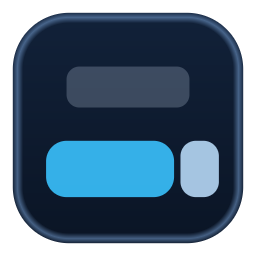

<p align="center">
  
</p>

<h1 align="center">PuwBar</h1>

<p align="center"><b>Taskbar kính mờ nổi cho Windows 11, giữ nguyên mọi tính năng gốc.</b></p>

<p align="center">
  Tách thanh taskbar gốc thành các cụm kính nổi bo góc cho ứng dụng, System Tray và Widgets.<br>
  Viết bằng Rust + C++/WinRT, một file exe ~870 KB duy nhất, không cần Windhawk, không cần cài Visual C++ Redistributable.
</p>

<p align="center"><b>Tiếng Việt</b> · <a href="README.en.md">English</a> · <a href="https://github.com/erikpuw/puwbar/releases">Bản mới nhất: v1.0.4</a></p>

> **Chỉ tải từ nguồn của tác giả.** PuwBar do tác giả (erikpuw) phát hành duy nhất tại [github.com/erikpuw/puwbar](https://github.com/erikpuw/puwbar). Bản tải từ nơi khác (trang chia sẻ, kho khác, bản đóng gói lại, tệp gửi qua mạng) không do tác giả kiểm soát và không được đảm bảo: có thể đã bị sửa đổi hoặc chèn thêm mã. Hãy chỉ dùng bản ở mục [Releases](https://github.com/erikpuw/puwbar/releases) của kho này.

## Tính năng

| Tính năng | Làm gì |
|---|---|
| **Kính mờ thật** | Làm mờ nền phía sau theo thời gian thực qua `Windows.UI.Composition` (`CreateBackdropBrush` + `D2D1GaussianBlur`), viền trắng mảnh 15%, bo góc 12px. |
| **Giữ nguyên bản gốc** | Không ẩn hay thay thế Explorer. Giữ đủ animation tray (RunCat 365, UniKey), menu chuột phải gốc, lưới icon overflow, Start menu và xem trước cửa sổ. |
| **Đủ 4 cạnh & Left/Center** | Tự xoay bố cục theo thời gian thực khi đổi vị trí taskbar (**Bottom / Top / Left / Right**) hoặc căn lề (**Left / Center**) trong Windows Settings. |
| **Sửa vạch cạnh phải** | Khóa đúng vạch đánh dấu ứng dụng đang chạy về cạnh phải khi đặt taskbar dọc bên phải màn hình. |
| **Bọc kính đồng bộ** | Áp cùng lớp kính cho cụm System Tray, menu chuột phải ở tray, Jump List ứng dụng, tooltip, khung xem trước cửa sổ, Quick Settings, Thông báo, Lịch, popup overflow (`^`, `...`) và nút Widgets. |
| **Trượt ngang mượt** | Nhịp trượt 300ms khớp với animation mở/đóng ứng dụng của Windows 11, khóa VSync theo tần số quét màn hình. |
| **Nhẹ & 1 file duy nhất** | Chạy nền khoảng 1,2 MB RAM và 0% CPU. Thư viện TAP và icon được nhúng sẵn trong `puwbar.exe`, thoát ra là trả taskbar về nguyên bản. |
| **Menu tray** | Khởi động cùng Windows, Áp dụng lại giao diện, Ngôn ngữ (Tiếng Việt / English), Giới thiệu, Thoát (`Ctrl+Alt+F12`). |

**Khởi động cùng Windows** hỏi quyền quản trị một lần khi bật để tạo tác vụ Task Scheduler chạy ngay lúc đăng nhập (không trễ, tự chờ Explorer XAML sẵn sàng trong 30 giây). Nếu từ chối UAC, chương trình tự chuyển sang khóa `HKCU\...\Run`. Bỏ tick thì tắt.

## Cài đặt và dùng

1. Tải `puwbar.exe` từ mục [Releases](https://github.com/erikpuw/puwbar/releases), đặt vào một thư mục cố định rồi chạy trực tiếp.
2. Bấm vào icon PuwBar trong System Tray để bật **Khởi động cùng Windows** hoặc đổi ngôn ngữ.
3. Nhấn `Ctrl+Alt+F12` hoặc chọn **Thoát PuwBar** ở tray để thoát và trả lại taskbar gốc mà không cần khởi động lại Explorer.

Nếu máy đang bật mod chỉnh giao diện taskbar trong Windhawk (như `Windows 11 Taskbar Styler`), nên tắt mod đó để tránh hai bên cùng ghi đè thuộc tính XAML.

## Build từ mã nguồn

Cần Windows 11 (x64), Rust stable, MSVC Build Tools và Windows SDK (`10.0.26100.0` trở lên có `xamlom.h` và C++/WinRT).

```powershell
cargo test
cargo clippy --all-targets -- -D warnings
cargo build --release
```

File thực thi nằm tại `target\release\puwbar.exe`. `build.rs` tự biên dịch `tap/puwbar_tap.cpp` và nhúng kèm `assets/puwbar.ico`.

## Giấy phép

Phát hành theo giấy phép MIT, xem [LICENSE](LICENSE).
