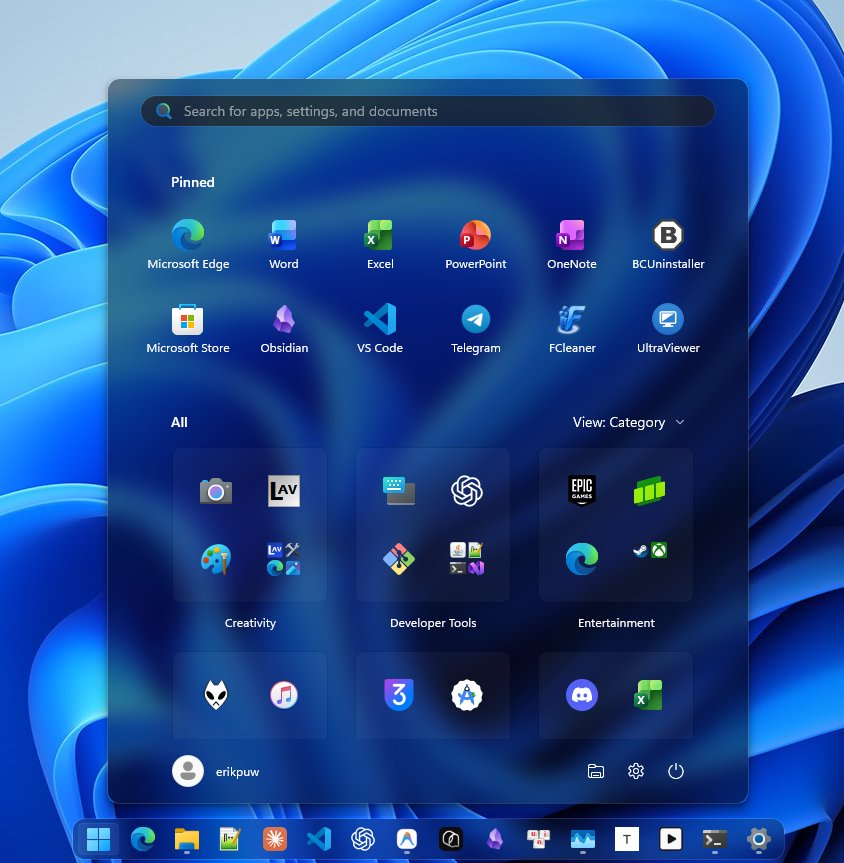
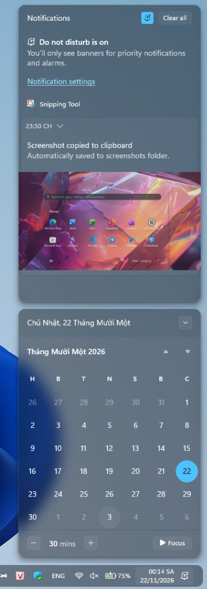
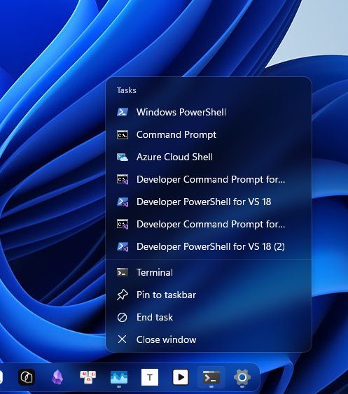
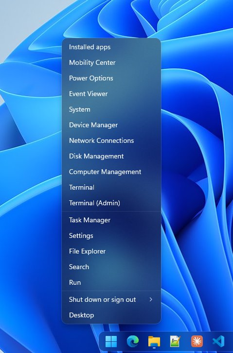
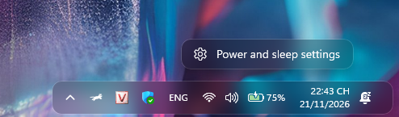
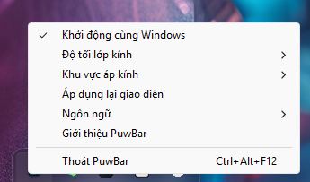
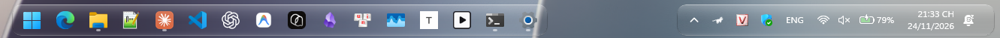

<p align="center">
  
</p>

<h1 align="center">PuwBar</h1>

<p align="center"><b>Taskbar kính mờ nổi cho Windows 11, giữ nguyên mọi tính năng gốc.</b></p>

<p align="center">
  Tách thanh taskbar gốc thành các cụm kính nổi bo góc cho ứng dụng, System Tray và Widgets.<br>
  Viết bằng Rust + C++/WinRT, bộ cài đặt Windows ~750 KB, không cần Windhawk, không cần cài Visual C++ Redistributable.
</p>

<p align="center"><b>Tiếng Việt</b> · <a href="README.en.md">English</a> · <a href="https://github.com/erikpuw/puwbar/releases/latest"></a></p>

> **Chỉ tải từ nguồn của tác giả.** PuwBar do tác giả (erikpuw) phát hành duy nhất tại [github.com/erikpuw/puwbar](https://github.com/erikpuw/puwbar). Bản tải từ nơi khác (trang chia sẻ, kho khác, bản đóng gói lại, tệp gửi qua mạng) không do tác giả kiểm soát và không được đảm bảo: có thể đã bị sửa đổi hoặc chèn thêm mã. Hãy chỉ dùng bản ở mục [Releases](https://github.com/erikpuw/puwbar/releases) của kho này.

## Tính năng

| Tính năng | Làm gì |
|---|---|
| **Kính mờ thật** | Làm mờ nền phía sau theo thời gian thực qua `Windows.UI.Composition` (`CreateBackdropBrush` + `D2D1GaussianBlur`), viền kính `1px` sáng ở mép trên, tối dần ở hai cạnh để tạo độ dày, kèm bóng nổi `ThemeShadow`, bo góc 12px. |
| **Giữ nguyên bản gốc** | Không ẩn hay thay thế Explorer. Giữ đủ animation tray (RunCat 365, UniKey), menu chuột phải gốc, lưới icon overflow, Start menu và xem trước cửa sổ. |
| **Đủ 4 cạnh & Left/Center** | Tự xoay bố cục theo thời gian thực khi đổi vị trí taskbar (**Bottom / Top / Left / Right**) hoặc căn lề (**Left / Center**) trong Windows Settings. |
| **Sửa vạch cạnh phải** | Khóa đúng vạch đánh dấu ứng dụng đang chạy về cạnh phải khi đặt taskbar dọc bên phải màn hình. |
| **Bọc kính đồng bộ** | Áp cùng lớp kính cho cụm System Tray, Start Menu, menu chuột phải ở tray, Jump List ứng dụng, tooltip, khung xem trước cửa sổ, Quick Settings, Thông báo, Lịch, popup overflow (`^`, `...`) và nút Widgets. |
| **Trượt ngang mượt** | Nhịp trượt 300ms khớp với animation mở/đóng ứng dụng của Windows 11, khóa VSync theo tần số quét màn hình. |
| **Nhẹ & gọn** | Chạy nền khoảng 1,2 MB RAM và 0% CPU. Cài đặt cố định và gỡ sạch qua Windows Installed apps, thoát ra là trả taskbar về nguyên bản. |
| **Menu tray** | Khởi động cùng Windows, Kiểu giao diện (Kính mờ / Kính trong suốt / Không viền phản chiếu icon / Kính mờ phẳng), Độ tối lớp kính (24% / 45% / 62%), Khu vực áp kính (bật/tắt riêng từng bảng về gốc Windows), Áp dụng lại giao diện, Ngôn ngữ (Tiếng Việt / English), Giới thiệu, Thoát (`Ctrl+Alt+F12`). |

**Khởi động cùng Windows** hỏi quyền quản trị một lần khi bật để tạo tác vụ Task Scheduler chạy ngay lúc đăng nhập (không trễ, tự chờ Explorer XAML sẵn sàng trong 30 giây). Nếu từ chối UAC, chương trình tự chuyển sang khóa `HKCU\...\Run`. Bỏ tick thì tắt.

## Ảnh chụp

| | |
|---|---|
| <br>**Start Menu & Taskbar**: kính mờ nổi bo góc 12px, viền trắng mảnh | <br>**Control Center & System Tray**: đồng bộ cùng một lớp kính mờ |
| <br>**Thông báo & Lịch**: đọc rõ chữ trắng cả trên nền sáng | <br>**Jump List**: menu chuột phải trên biểu tượng ứng dụng |
| <br>**Menu Win+X**: menu chuột phải nút Start | <br>**Menu System Tray**: giữ nguyên bấm chọn chuột trái bình thường |
| <br>**Menu PuwBar (Tiếng Việt)**: chỉnh độ tối lớp kính & bật/tắt từng khu vực | <br>**Menu PuwBar (English)**: đổi ngôn ngữ ngay trong menu tray |

### Kiểu taskbar

Chọn trong menu tray, mục **Kiểu giao diện**.

**Kính mờ** (mặc định): nền phía sau nhòe nhẹ nhưng vẫn thấy hình khối, mặt kính có vệt bóng loáng nên nhìn ra tấm kính nổi khối.


**Kính trong suốt**: không làm mờ nền, chỉ giữ viền kính và vệt bóng mềm.



**Không viền (phản chiếu icon)**: bỏ khung kính, icon in bóng xuống phía dưới như đặt trên mặt bàn kính.


**Kính mờ phẳng**: giao diện kính của v1.0.6, viền trắng mảnh đều, không bóng đổ, không vệt bóng loáng.


## Cài đặt và dùng

1. Nếu đang chạy bản PuwBar cũ, hãy thoát trước khi cài (`Ctrl+Alt+F12` hoặc chọn **Thoát PuwBar** ở System Tray).
2. Tải bộ cài `puwbar-setup-v<version>-x64.exe` (~750 KB) từ mục [Releases](https://github.com/erikpuw/puwbar/releases/latest) và chạy trực tiếp.
3. Trình cài đặt sẽ cài `puwbar.exe` vào `%LOCALAPPDATA%\Programs\PuwBar`, tạo shortcut Start Menu và đăng ký mục gỡ cài đặt trong **Installed apps**.
4. Nếu giữ tick **Chạy cùng Windows khi đăng nhập**, Windows sẽ hiện hộp thoại UAC xin quyền Quản trị viên để đăng ký tác vụ Task Scheduler không độ trễ (`HighestAvailable`). Từ chối UAC sẽ tự chuyển sang khởi động thường qua `HKCU\...\Run`.
5. Bấm vào icon PuwBar ở System Tray để chỉnh độ tối lớp kính, bật/tắt từng khu vực hoặc đổi ngôn ngữ. Nhấn `Ctrl+Alt+F12` hay chọn **Thoát PuwBar** để trả lại taskbar gốc mà không cần khởi động lại Explorer.

Nếu máy đang bật mod chỉnh giao diện taskbar trong Windhawk (như `Windows 11 Taskbar Styler`), nên tắt mod đó để tránh hai bên cùng ghi đè thuộc tính XAML.

## Build từ mã nguồn

Cần Windows 11 (x64), Rust stable, MSVC Build Tools và Windows SDK (`10.0.26100.0` trở lên có `xamlom.h` và C++/WinRT).

```powershell
cargo test --workspace
cargo clippy --workspace --all-targets -- -D warnings
powershell -ExecutionPolicy Bypass -File .\scripts\build-dist.ps1
```

Lệnh trên sẽ biên dịch `target\release\puwbar.exe`, đóng gói trình cài đặt và xuất ra `dist\puwbar-setup-v<version>-x64.exe`. `build.rs` tự biên dịch `tap/puwbar_tap.cpp` và nhúng kèm `assets/puwbar.ico`.

## Giấy phép

Phát hành theo giấy phép MIT, xem [LICENSE](LICENSE).
